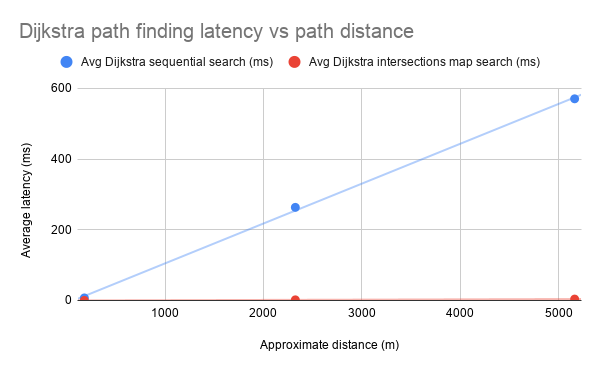

# Building Google Maps

A command-line route planner written in C. It loads real street data for Barcelona, finds where you are from an address, a place name or a coordinate, and prints turn-by-turn directions along the shortest path.

Built by a team of three for the Data Structures and Algorithms course at Universitat Pompeu Fabra (2025/26): [MarcAltabella](https://github.com/MarcAltabella), [dmarijan85](https://github.com/dmarijan85) and [AyBeeee](https://github.com/AyBeeee). The course provided the problem statement, the map datasets and the build scaffolding; the code in `src/` is ours.

## Example

```text
$ make r
Enter map name (e.g. 'xs_2' or 'xl_1'): xl_1
Houses loaded: 71092
Places loaded: 21349
Streets loaded: 18944

--- ORIGIN ---
Found at (41.401801, 2.196913)
Closest street: carrer de pere iv

--- DESTINATION ---
Found at (41.404192, 2.195074)
Closest street: carrer de tànger

--- ROUTE ---
Start at carrer de pere iv
Continue to carrer de pere iv and continue for 156m
Turn left to rambla del poblenou and continue for 247m
Turn left to carrer de tànger and continue for 145m
You have arrived at carrer de tànger!
```

The output is shortened here; the program also prints the prompts and the streets connected to each end.

## What we implemented

| Part | How it works | File |
| --- | --- | --- |
| Address and place lookup | Linear search over linked lists of houses and places. When there is no exact match, it suggests the three closest names by Levenshtein distance. | [`src/find.c`](src/find.c), [`src/utils.c`](src/utils.c) |
| Closest street to a coordinate | Haversine distance from the coordinate to the midpoint of every street segment. | [`src/find.c`](src/find.c) |
| Street graph | A hash table from intersection id to the street segments leaving it, so connected streets are found without scanning the whole list. | [`src/hash.c`](src/hash.c), [`src/init.c`](src/init.c) |
| Route finding | Dijkstra's algorithm weighted by segment length in metres, with a hash table of visited segments. A breadth-first search version is also in the code. | [`src/traversal.c`](src/traversal.c) |

## Measured results

We timed the same searches with and without the intersection hash table. Full method, raw data and complexity analysis are in the [report](docs/REPORT.md).

| Route on the `xl_1` map (18,944 street segments) | Scanning the street list | Intersection hash table |
| --- | ---: | ---: |
| Close, about 180 m | 7.16 ms | 0.08 ms |
| Medium, about 2.3 km | 263.2 ms | 1.70 ms |
| Far, about 5.2 km | 570.2 ms | 3.88 ms |



Known limits, also covered in the report: the list of pending paths in Dijkstra is a sorted linked list, not a binary heap, and the closest-street search checks every segment. The report describes how a heap and a spatial grid would improve them.

## Run it

You need `gcc` and `make`. See the [developer setup](docs/DEVELOPER_SETUP.md) for the course's full environment.

```zsh
make r        # build and run
make t        # unit tests
make latency  # timing experiments
make v        # Valgrind leak check (Linux)
make f        # format the code
```

When prompted, choose one of the maps in [`maps/`](maps/), from `xs_1` (13 street segments) to `2xl_1` (50,623).

## Repository contents

- [`src/`](src/): the program
- [`test/`](test/): unit tests, run on every push by GitHub Actions
- [`docs/REPORT.md`](docs/REPORT.md): complexity analysis and latency experiments
- [`docs/PROBLEM.md`](docs/PROBLEM.md): the course's problem statement
- [`maps/`](maps/): map datasets derived from OpenStreetMap (© OpenStreetMap contributors)
- [`maps_builder/`](maps_builder/README.md): scripts to build your own maps
