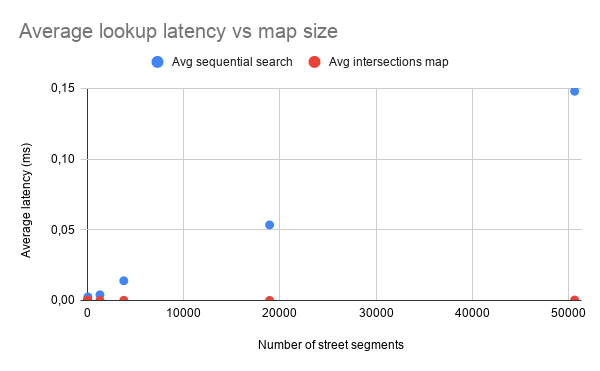
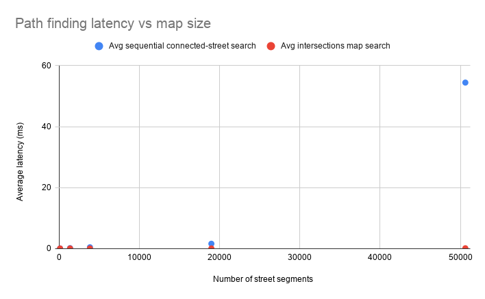
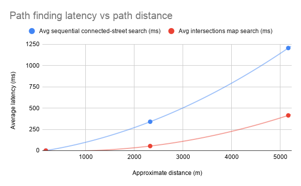

# Report

## 1. Initializing the intersections map

I use `S` for the number of street segments and `I` for the number of different intersections.

In our program, the intersections map is initialized after loading the streets. First, `unique_intersections` counts how many different intersection ids appear in the street list. This value is used to choose the size of the hash table. Then `create_hashmap` allocates the table and initializes every bucket to `NULL`. Finally, `load_streets_into_graph` goes through the street list and inserts each street into the hash table using its intersection id.

The best case is `O(S + I)`, which simplifies to `O(S)` because the number of intersections is at most proportional to the number of street segments. This happens when checking whether an intersection was already seen stays cheap, for example when many streets share the same intersections.

The average and worst cases in the current implementation are `O(S^2)`. The reason is that `unique_intersections` stores the ids it has already found in an array. For each street, it may scan that array to check if the `from` or `to` intersection id was already inserted. If many streets have different intersection ids, this nested search becomes quadratic.

After the table is created, loading the streets into the hash map is `O(S)` on average if the hash function distributes ids well. However, the `O(S^2)` cost of counting unique intersections dominates the total complexity. If the unique intersections were counted with a hash set instead of an array search, the average initialization cost could be improved to `O(S)`.

## 2. Finding the coordinates of a street or place

I use `H` for the number of houses, `P` for the number of places, and `L` for the length of the name string.

The program stores houses and places in linked lists. To find an address, it scans the houses list until it finds a node with the same street name and house number. To find a place, it scans the places list until it finds a matching place name. Both operations are sequential searches.

For an address, the best case is `O(1)` if the correct house is the first element in the list. The average case is `O(H)` because the program may need to check many houses before finding the correct one. The worst case is `O(H)` if the house is at the end of the list or is not found.

For a place, the best case is also `O(1)` if the place is found at the beginning of the places list. The average case is `O(P)`, and the worst case is `O(P)`. If there are multiple places with the same name, the program may scan the places list again to print and select the correct option, but this is still linear.

If the program does not find an exact match, it calculates Levenshtein distance to suggest similar street or place names. Comparing two strings with Levenshtein distance costs `O(L^2)` if both strings have length around `L`. In that case, the worst case becomes `O(H * L^2)` for houses or `O(P * L^2)` for places. If we treat name length as small and limited, the main cost is still the linear scan through the list.

## 3. Path-finding algorithm

The path-finding algorithm used in the final program is Dijkstra's algorithm. I use `V` for the number of visited street segments or intersections, and `E` for the number of street connections explored.

Dijkstra starts from the origin street and always explores the currently shortest known path first. In our implementation, the weight of a street connection is the street segment length in meters. This means the path found is based on distance, not only on the number of street segments.

The algorithm keeps a `visited` hash table so that the same street segment is not processed many times. It also keeps a pending list of paths to explore, ordered by total distance. When a new path is created, it is inserted into this list in the correct position.

The best case is `O(1)` if the origin is already the destination or if the destination is found immediately.

Finding connected streets with the intersections map is `O(1)` on average for each lookup, and checking `visited` is also `O(1)` on average. However, our pending paths are stored in a sorted linked list, not in a binary heap. Inserting a new path can take `O(E)` in the worst case because the program may need to scan through the pending list to find the correct position.

Because of this sorted linked list, the average and worst case complexity of our Dijkstra implementation can be up to `O(E^2)`. In a road map, where the number of connections is usually close to the number of visited street segments, this often behaves closer to `O(V^2)`. If the pending paths were stored in a binary heap priority queue, the complexity could be improved to `O((V + E) log V)`.

## 4. Connected streets: list search vs intersections map by map size

| Map | Street segments | Avg sequential search (ms) | Avg intersections map (ms) |
|---|---:|---:|---:|
| xs_1 | 13 | 0.0001 | 0.0003 |
| xs_2 | 71 | 0.0025 | 0.0001 |
| md_1 | 1318 | 0.0040 | 0.0000 |
| lg_1 | 3797 | 0.0139 | 0.0001 |
| xl_1 | 18944 | 0.0534 | 0.0000 |
| 2xl_1 | 50623 | 0.1479 | 0.0003 |

The sequential list search becomes slower as the map size grows because it scans the whole street segment list to find all streets connected to the chosen intersection. Larger maps have more street segments, so more comparisons are needed.

The intersections map stays almost constant because the intersection id is used to access the corresponding bucket directly. This avoids scanning all street segments, so it scales much better on larger maps.

### Raw data

All values are in milliseconds.

Click to show raw latency data

| Test | xs_1 sequential | xs_1 map | xs_2 sequential | xs_2 map | md_1 sequential | md_1 map | lg_1 sequential | lg_1 map | xl_1 sequential | xl_1 map | 2xl_1 sequential | 2xl_1 map |
|---|---:|---:|---:|---:|---:|---:|---:|---:|---:|---:|---:|---:|
| Test 1 | 0.001 | 0.000 | 0.001 | 0.000 | 0.004 | 0.000 | 0.021 | 0.000 | 0.052 | 0.000 | 0.245 | 0.002 |
| Test 2 | 0.000 | 0.000 | 0.018 | 0.000 | 0.004 | 0.000 | 0.020 | 0.001 | 0.053 | 0.000 | 0.144 | 0.000 |
| Test 3 | 0.000 | 0.000 | 0.001 | 0.000 | 0.004 | 0.000 | 0.018 | 0.000 | 0.062 | 0.000 | 0.138 | 0.000 |
| Test 4 | 0.000 | 0.001 | 0.001 | 0.000 | 0.004 | 0.000 | 0.012 | 0.000 | 0.050 | 0.000 | 0.136 | 0.001 |
| Test 5 | 0.000 | 0.000 | 0.001 | 0.000 | 0.004 | 0.000 | 0.011 | 0.000 | 0.052 | 0.000 | 0.138 | 0.000 |
| Test 6 | 0.000 | 0.001 | 0.001 | 0.000 | 0.004 | 0.000 | 0.011 | 0.000 | 0.055 | 0.000 | 0.136 | 0.000 |
| Test 7 | 0.000 | 0.001 | 0.001 | 0.000 | 0.004 | 0.000 | 0.012 | 0.000 | 0.053 | 0.000 | 0.134 | 0.000 |
| Test 8 | 0.000 | 0.000 | 0.001 | 0.000 | 0.004 | 0.000 | 0.012 | 0.000 | 0.052 | 0.000 | 0.137 | 0.000 |
| Test 9 | 0.000 | 0.000 | 0.000 | 0.000 | 0.004 | 0.000 | 0.011 | 0.000 | 0.052 | 0.000 | 0.134 | 0.000 |
| Test 10 | 0.000 | 0.000 | 0.000 | 0.001 | 0.004 | 0.000 | 0.011 | 0.000 | 0.053 | 0.000 | 0.137 | 0.000 |

## 5. Path finding: list search vs intersections map by map size

This experiment compares the latency of finding a path using sequential connected-street search and using the intersections map. The same origin and destination were used for every map.

Origin: `41.403429, 2.193660`
Destination: `41.404986, 2.194211`

`xs_1` was skipped because it was too small for this path.

| Map   | Street segments | Avg sequential connected-street search (ms) | Avg intersections map search (ms) |
| ----- | --------------: | ------------------------------------------: | --------------------------------: |
| xs_2  |              71 |                                      0.0038 |                            0.0013 |
| md_1  |            1318 |                                      0.1072 |                            0.0014 |
| lg_1  |            3797 |                                      0.3875 |                            0.0015 |
| xl_1  |           18944 |                                      1.5542 |                            0.0026 |
| 2xl_1 |           50623 |                                     54.4489 |                            0.0677 |

The results show that sequential connected-street search becomes much slower as the map size increases. This happens because the algorithm repeatedly has to find the streets connected to an intersection, and doing this sequentially requires scanning through the street segments.

Using the intersections map is much faster because the connected streets are already grouped by intersection. Instead of scanning the whole street segment list, the algorithm directly accesses the bucket for the current intersection.

The intersections map scales much better. Even though its latency increases slightly in the largest map, it remains much lower than the sequential approach.

### Raw data

All values are in milliseconds.

Click to show raw latency data

| Test    | xs_2 sequential | xs_2 map | md_1 sequential | md_1 map | lg_1 sequential | lg_1 map | xl_1 sequential | xl_1 map | 2xl_1 sequential | 2xl_1 map |
| ------- | --------------: | -------: | --------------: | -------: | --------------: | -------: | --------------: | -------: | ---------------: | --------: |
| Test 1  |           0.005 |    0.002 |           0.116 |    0.003 |           0.393 |    0.005 |           1.464 |    0.010 |           54.409 |     0.139 |
| Test 2  |           0.004 |    0.002 |           0.114 |    0.001 |           0.380 |    0.002 |           1.458 |    0.002 |           52.458 |     0.062 |
| Test 3  |           0.003 |    0.003 |           0.106 |    0.002 |           0.382 |    0.001 |           1.453 |    0.002 |           59.350 |     0.060 |
| Test 4  |           0.003 |    0.001 |           0.109 |    0.002 |           0.435 |    0.001 |           1.624 |    0.001 |           53.229 |     0.062 |
| Test 5  |           0.004 |    0.001 |           0.103 |    0.001 |           0.386 |    0.001 |           1.573 |    0.002 |           52.347 |     0.060 |
| Test 6  |           0.006 |    0.001 |           0.103 |    0.001 |           0.382 |    0.001 |           2.150 |    0.002 |           54.368 |     0.059 |
| Test 7  |           0.003 |    0.000 |           0.104 |    0.001 |           0.379 |    0.001 |           1.517 |    0.002 |           53.031 |     0.059 |
| Test 8  |           0.004 |    0.001 |           0.108 |    0.001 |           0.383 |    0.001 |           1.510 |    0.002 |           53.188 |     0.059 |
| Test 9  |           0.003 |    0.001 |           0.101 |    0.001 |           0.377 |    0.001 |           1.402 |    0.001 |           58.593 |     0.058 |
| Test 10 |           0.003 |    0.001 |           0.108 |    0.001 |           0.378 |    0.001 |           1.391 |    0.002 |           53.516 |     0.059 |

## 6. Path finding: latency by distance

This experiment compares the latency of finding a path between close, medium, and far points in the same map. The map used for every test was `xl_1`.

| Distance case | Approximate distance (m) | Avg sequential connected-street search (ms) | Avg intersections map search (ms) |
| ------------- | -----------------------: | ------------------------------------------: | --------------------------------: |
| Close         |                   179.64 |                                      0.7157 |                            0.0026 |
| Medium        |                  2324.36 |                                    339.6005 |                           53.8064 |
| Far           |                  5163.80 |                                   1205.7942 |                          413.8119 |

The results show that path finding latency increases as the origin and destination become farther apart. This happens because longer paths require the algorithm to explore more intersections and street segments before reaching the destination.

The sequential connected-street search is slower because, every time the algorithm needs the streets connected to an intersection, it may have to scan through the street segment list. The intersections map version is faster because the connected streets are already grouped by intersection, so the algorithm can access them directly.

I fitted a polynomial curve of degree 2. This is reasonable because the cost does not grow perfectly linearly with distance: as the destination gets farther away, BFS may explore a larger part of the graph. According to the path-finding complexity from question 3, the total cost depends on the number of explored streets and connections. The sequential version also has the extra cost of repeatedly scanning the street list, while the intersections map reduces the neighbor lookup cost.

### Raw data

All values are in milliseconds.

Click to show raw latency data

| Test    | Close sequential | Close map | Medium sequential | Medium map | Far sequential | Far map |
| ------- | ---------------: | --------: | ----------------: | ---------: | -------------: | ------: |
| Test 1  |            0.714 |     0.011 |           340.881 |     54.244 |       1199.680 | 412.507 |
| Test 2  |            0.698 |     0.002 |           341.862 |     54.154 |       1198.147 | 413.164 |
| Test 3  |            0.696 |     0.002 |           340.792 |     53.575 |       1207.209 | 413.316 |
| Test 4  |            0.694 |     0.002 |           337.681 |     53.842 |       1231.501 | 413.187 |
| Test 5  |            0.693 |     0.001 |           338.766 |     53.441 |       1202.775 | 412.564 |
| Test 6  |            0.688 |     0.002 |           338.230 |     53.677 |       1207.123 | 411.757 |
| Test 7  |            0.704 |     0.001 |           338.087 |     53.889 |       1199.328 | 417.701 |
| Test 8  |            0.790 |     0.002 |           338.637 |     53.627 |       1207.245 | 413.562 |
| Test 9  |            0.745 |     0.001 |           342.810 |     53.861 |       1204.102 | 418.079 |
| Test 10 |            0.735 |     0.002 |           338.259 |     53.754 |       1200.832 | 412.282 |

## 7. Improving the visited data structure in BFS

The improvement for the `visited` data structure is to use a hash table instead of a list/queue. In our final implementation, visited street segments are stored in a hash table. The bucket is chosen using an intersection id, and the stored street segment is compared to know if it was already visited.

This is useful because BFS checks `visited` very often. If `visited` is a list, the program has to scan the list to know whether a street was already visited. With a hash table, the program goes directly to the corresponding bucket and only checks the streets stored there.

With a list approach, checking if a street is already in `visited` costs `O(V)` in the worst case, where `V` is the number of visited streets. Since BFS performs this check many times while exploring connected streets, the total cost can become `O(E * V)`, where `E` is the number of connections explored. In road maps, `E` is usually close to `V`, so this can behave like `O(V^2)`.

With the hash table, checking if a street was already visited is `O(1)` on average. This improves BFS to `O(V + E)` on average, because each visited street and each connection is processed a constant number of times. The worst case can still be worse if many keys collide in the same bucket, but with a good table size the average case is much better than using a list.

The main trade-off is memory usage. A hash table needs extra memory for the buckets, while a list only stores the visited streets one after another. It also makes the code a little more complex, because we need a hash function and insert/search operations. For larger maps, this trade-off is worth it because BFS checks `visited` very often.

## 8. Improving closest street search from latitude and longitude

The current algorithm to find the closest street segment checks every street segment in the map. For each street, it calculates the distance between the user's coordinate and the midpoint of that street segment. It keeps the street with the smallest distance and returns it at the end. This is simple and correct, but it is slow for large maps because it always scans the full street list.

The improvement I would use is a spatial grid index. The idea is to divide the map into small rectangular cells using latitude and longitude. When the map is loaded, each street segment is inserted into the cell where its midpoint is located. Then, when the user gives a coordinate, the program checks the streets in the same cell and nearby cells instead of checking the whole map.

I would choose a grid index because it is simpler to implement and understand than a more advanced structure like a k-d tree or quadtree. It also fits this project because the street data is already based on latitude and longitude.

With the current list approach, the runtime complexity is `O(S)` for every search, where `S` is the number of street segments. This is because the program must calculate the distance to every street midpoint.

With a spatial grid, building the grid would cost `O(S)` when the map is loaded, because every street segment must be inserted once. After that, searching for the closest street would be much faster on average. If only `K` street segments are in the nearby cells that we check, the average search cost becomes `O(K)`, where `K` is usually much smaller than `S`. In the best case, the correct nearby cell contains very few streets, so the search is close to `O(1)`. The worst case can still be `O(S)` if many streets are in the same cell, or if the program has to expand the search to many cells.

The main trade-off is memory usage. The grid stores extra lists of street segments for each cell, so it uses more memory than only keeping one linked list of all streets. There is also an extra preprocessing step when loading the map. Another downside is that the cell size must be chosen carefully. If the cells are too large, each cell contains too many streets and the search is still slow. If the cells are too small, the program may need to check many neighboring cells to avoid missing the closest street.
